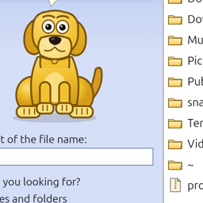

<div align="center">



# Rover Explorer

**A Windows XP-style file explorer for Linux and Windows — with the search companion dog, and search that is actually instant.**

**Documentation:** step-by-step guides at [learn.dhivalabs.com](https://learn.dhivalabs.com/apps/rover-explorer/): [install](https://learn.dhivalabs.com/apps/rover-explorer/install) · [beginner guide](https://learn.dhivalabs.com/apps/rover-explorer/getting-started) · [troubleshooting](https://learn.dhivalabs.com/apps/rover-explorer/faq).

A [Dhiva Labs](https://github.com/Dhiva-Labs) project · MIT licensed

[](https://github.com/Dhiva-Labs/rover_explorer/actions/workflows/ci.yml)


</div>

---

## What it is

Rover Explorer recreates the Windows XP Explorer experience — the Luna toolbar,
the task panes, the folder tree, details and icons views — and pairs it with a
modern, Everything-style search index that returns ranked results on every
keystroke across hundreds of thousands of files.

And it brings back the dog.

> The companion is an original character drawn entirely in code (`CustomPaint`).
> No Microsoft artwork, icons or audio are used anywhere in this project.

## Features

### Explorer

- Classic XP Luna chrome: gradient toolbar, beige dialogs, sunken fields.
- Menu bar — **File / Edit / View / Go / Tools / Help**.
- **Common Tasks** pane ("File and Folder Tasks", "Other Places", "Details")
  and a lazily-loaded **Folders** tree pane.
- Address bar with path entry and a **recent locations** drop-down.
- Details and icons views, sortable columns, folders grouped first.
- Full file management: open with the system handler, cut / copy / paste,
  rename, delete, new folder, multi-select, **drag & drop** onto folders,
  hidden-file toggle, **Properties** with background size counting.
- **Folder Options** for hidden files, the companion, sounds and the index.

### Instant search

- A background isolate keeps an in-memory filename index of your home tree
  (~450k entries index in seconds) and answers queries per keystroke.
- The index is cached to disk, so the next launch searches instantly while a
  refresh scan runs behind it.
- Ranked matching: exact > prefix > word-start > substring; extra words match
  anywhere in the full path (e.g. `screen rover_explorer`).
- Filters: All / Folders / Pictures / Music / Videos / Documents, plus
  "only in current folder".

### The companion

Click him, or leave him idle, and he performs the classic repertoire: barking
(with sound), reading a book, jumping, waving, licking, scratching, digging,
ear flaps, head tilts, tail wags, dozing off, and chasing a ball. While a
search runs he puts his nose to the ground and sniffs; when results land he
turns up with a bone.

## Keyboard shortcuts

| Action | Shortcut |
|---|---|
| Search Companion | `Ctrl+F` |
| New folder | `Ctrl+Shift+N` |
| Rename | `F2` |
| Delete | `Del` |
| Refresh | `F5` |
| Select all | `Ctrl+A` |
| Cut / Copy / Paste | `Ctrl+X` / `Ctrl+C` / `Ctrl+V` |
| Properties | `Alt+Enter` |
| Back / Forward / Up | `Alt+←` / `Alt+→` / `Alt+↑` or `Backspace` |

## Install

Releases after 1.0.0 carry x64 and arm64 builds, with a `SHA256SUMS.txt`
(1.0.0 itself is x64 only):

| Platform | x64 | arm64 |
|---|---|---|
| Debian / Ubuntu | `rover-explorer_<version>_amd64.deb` | `rover-explorer_<version>_arm64.deb` |
| Fedora, RHEL, openSUSE | `rover-explorer-<version>-1.x86_64.rpm` | `rover-explorer-<version>-1.aarch64.rpm` |
| Arch, Manjaro, EndeavourOS | `rover-explorer-<version>-1-x86_64.pkg.tar.zst` | `rover-explorer-<version>-1-aarch64.pkg.tar.zst` |
| Any distribution (AppImage) | `Rover-Explorer-<version>-x86_64.AppImage` | `Rover-Explorer-<version>-aarch64.AppImage` |
| Any distribution (Flatpak) | `rover-explorer-<version>-x86_64.flatpak` | `rover-explorer-<version>-aarch64.flatpak` |
| Linux portable | `rover-explorer-<version>-linux-x64.tar.gz` | `rover-explorer-<version>-linux-arm64.tar.gz` |
| Windows installer | `RoverExplorer-<version>-setup.exe` | `RoverExplorer-<version>-arm64-setup.exe` |
| Windows portable | `rover-explorer-<version>-windows-x64.zip` | `rover-explorer-<version>-windows-arm64.zip` |

### Debian / Ubuntu

```bash
sudo apt install ./rover-explorer_<version>_amd64.deb   # x86-64
sudo apt install ./rover-explorer_<version>_arm64.deb   # ARM64 (aarch64)
```

### Other Linux distributions

The `.rpm`, Arch package, AppImage and Flatpak are attached from the next
release on, together with an AUR recipe (`rover-explorer-bin-<version>-aur.tar.gz`,
PKGBUILD + .SRCINFO; not on the AUR yet). Each one is installed and started on
its distribution in CI before a release is published.

```bash
sudo dnf install ./rover-explorer-<version>-1.x86_64.rpm                         # Fedora, RHEL/Rocky/Alma
sudo zypper install --allow-unsigned-rpm ./rover-explorer-<version>-1.x86_64.rpm # openSUSE
sudo pacman -U ./rover-explorer-<version>-1-x86_64.pkg.tar.zst                   # Arch, Manjaro
chmod +x Rover-Explorer-<version>-x86_64.AppImage && ./Rover-Explorer-<version>-x86_64.AppImage
flatpak install --user ./rover-explorer-<version>-x86_64.flatpak                 # needs the flathub remote
```

- Everything is built on Ubuntu 24.04. The `.rpm` asks for the glibc it
  really uses, so dnf and zypper refuse a system that is too old; the
  AppImage needs GTK 3 and glibc 2.34 or newer from the system (Fedora 35+,
  RHEL 9, openSUSE Tumbleweed, current Arch).
- The `.rpm` is not signed, hence `--allow-unsigned-rpm` on openSUSE.
- The Flatpak needs the GNOME runtime from Flathub
  (`flatpak remote-add --user --if-not-exists flathub https://dl.flathub.org/repo/flathub.flatpakrepo`)
  and has access to the whole file system (`--filesystem=host`), as a file
  manager must.

### Windows

Run `RoverExplorer-<version>-setup.exe`, or unzip the portable build. On
Windows on ARM use `RoverExplorer-<version>-arm64-setup.exe` (or the
`windows-arm64` zip) for the native build; the x64 installer also works there,
through emulation.

## Build from source

Requires Flutter 3.44+.

```bash
flutter pub get

# Linux (build/linux/arm64/... on an ARM64 machine)
flutter build linux --release
./build/linux/x64/release/bundle/rover_explorer

# Debian package
bash packaging/linux/build-deb.sh

# Snap
snapcraft pack

# Windows
flutter build windows --release
iscc packaging\windows\rover-explorer.iss   # installer
dart run msix:create --store                # Microsoft Store package (.msix)

# Windows on ARM: build on an ARM64 machine, then
iscc /DArch=arm64 packaging\windows\rover-explorer.iss
dart run msix:create --store --architecture arm64 --build-windows false
```

Flutter cannot cross-compile desktop apps, so each architecture is built on a
machine of that architecture; CI does this on native x64 and arm64 runners.

## Development

```bash
dart format lib test
flutter analyze
flutter test
```

## Project layout

| Path | What it is |
|---|---|
| `lib/app_info.dart` | Product identity and version metadata |
| `lib/screens/explorer_screen.dart` | Main window: menus, toolbar, panes, actions |
| `lib/services/search_index.dart` | Indexer isolate: walk, cache, ranked queries |
| `lib/services/fs_service.dart` | Listing, drives, open-with-OS, copy/move/rename/delete |
| `lib/services/sound_service.dart` | Pluginless bark playback |
| `lib/widgets/rover_dog.dart` | The animated companion and his tricks |
| `lib/widgets/search_pane.dart` | Search Companion sidebar |
| `lib/widgets/folder_tree.dart` | Folders navigation pane |
| `lib/widgets/file_list.dart` | Details/icons views, selection, drag & drop |
| `lib/widgets/task_pane.dart` | Common Tasks sidebar |
| `lib/dialogs/` | About, Properties, Folder Options |
| `lib/xp/` | Luna palette, chrome widgets, dialog shell |
| `packaging/` | Debian, PPA and Windows installer manifests |
| `snap/snapcraft.yaml` | Snap package manifest |

The index cache lives in the platform application-support directory as
`rover_index.txt`; delete it to force a cold rebuild.

## Privacy

Rover Explorer works offline and sends nothing anywhere. See
[PRIVACY.md](PRIVACY.md).

## Sponsors

Dhiva Labs is an independent, self-funded lab. [Sponsorships](https://github.com/sponsors/Dhiva-Labs) help bring this project and the rest of Dhiva Labs to every platform, iPhone and Mac included.

[](https://github.com/sponsors/Dhiva-Labs)

Monthly sponsors at $10 and up are listed here:

<!-- sponsors -->
*Be the first: [sponsor Dhiva Labs](https://github.com/sponsors/Dhiva-Labs).*
<!-- sponsors -->

## Licence

MIT — see [LICENSE](LICENSE). Rover Explorer is an independent project and is
not affiliated with or endorsed by Microsoft Corporation.
